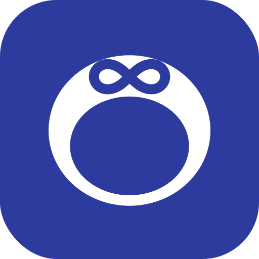

# Open Ring

An Android app for the Oura Ring that works without the Oura app, account or subscription.
It reads the ring over Bluetooth and does all the math on your phone. It has no internet access,
so your data stays with you.

Hobby project, built on the reverse engineering work of [open_oura and open_health](#credits-and-license).
Not affiliated with Oura, not a medical device.

&nbsp;
&nbsp;

Demo data on an Android emulator, updated automatically from the main branch.

## What it does

* Sleep stages, night timeline, your last nights and your average night
* Readiness, activity, heart rate, HRV, temperature, blood oxygen
* Your phone's screen time with a score, shown as a clock next to your sleep; apps like maps can be left out.
  It also helps tell sleep from lying still with the phone
* Live heart rate and blood oxygen on demand
* A demo mode, so you can look around without a ring

## Install

Android 8.0 or newer.

1. Download the APK from the [latest release](https://github.com/busssard/OpenRing/releases/latest) on your phone and open it.
2. Allow your browser to install apps when Android asks, then tap **Install**.
3. If Play Protect warns you (it does for anything not from the Play Store): **More details**, then **Install anyway**.

Updates install over the old version and keep your data.

Is it safe?

* The app has no internet permission, so Android blocks it from sending anything anywhere.
  [A check](tests/check_privacy.sh) in every build makes sure that never changes.
* Every release APK is built by GitHub from this code after the tests pass. The release notes list
  its checksum, signing certificate and a link to the build, and it has a
  [provenance attestation](https://docs.github.com/en/actions/security-for-github-actions/using-artifact-attestations)
  (`gh attestation verify OpenRing-x.y.apk -R busssard/OpenRing`).
* Each change runs about 200 automated tests ([results and coverage](https://github.com/busssard/OpenRing/blob/badges/summary.md)),
  is tested on an Android 14 emulator ([runs](https://github.com/busssard/OpenRing/actions/workflows/emulator.yml))
  and scanned by [CodeQL](https://github.com/busssard/OpenRing/actions/workflows/codeql.yml).
* All releases share one signing key, so nobody else can push an update to your phone.

More in [SECURITY.md](SECURITY.md).

Google's upcoming install rules

Google is starting developer verification for apps outside the Play Store (some countries from
September 2026, worldwide planned for 2027). Unverified apps will then need a one time setting in the
developer options. This page will explain the steps if it comes to that.

## Getting started

Works with Oura Ring Gen 3, Ring 4 and Ring 5 (tested mostly on Ring 4). Or tap
**Just looking? Explore with demo data** on the first screen to look around without a ring.

1. Allow Bluetooth access.
2. Enter age, sex, weight and height (used for calories, goals and age adjusted sleep targets).
3. Connect the ring. It only talks to apps that know its pairing key (32 characters). Three ways:
   * **Use my existing key**: the key the official Oura app uses; the official app keeps working too.
     Paste it with the **Paste** button. Tick *Install this key on a factory reset ring* only if the
     ring was reset since.
   * **Restore from a backup**: a backup file saved in Open Ring (Settings, Key and backup) brings back
     the key and settings, a full backup also all history. A text file holding only the key works too.
   * **Pair and create a new key**: for a factory reset ring. The official app then stops working until
     the ring is reset again. To reset a Gen 3 or Ring 4 on its dock: take the ring off, put it back and
     wait 2 seconds, then flip the dock upside down until it glows blue, upright until red, upside down
     until purple, upright until yellow. Yellow means the reset started; blinking blue means done.
4. Back up the key the app shows you. It cannot be read back from the ring.

Where do I find the key of the official app?

* iPhone: make an unencrypted local backup and read `assa.sqlite` (table `ringconfiguration`, column `auth_key`).
* Rooted Android: `tools/android_oura_key_extract.py` from the [open_oura](https://github.com/Th0rgal/open_oura) project.

Keep the ring on its charger near the phone for the first sync, which copies the ring's whole history and can
take a while. Close the official Oura app during syncs; the ring accepts only one Bluetooth link.
Afterwards the app syncs when you open it (at most every half hour) and about every three hours in the
background (can be switched off in Settings).

## If something does not show up

Open Settings, Help, **Data check and log**. It follows your data from the ring to the screen and
shows the step where it stops, with a hint what to do. *Repair* dates and analyses everything already
stored again, without a new sync.
The data check contains no health values, so you can paste it into a
[bug report](https://github.com/busssard/OpenRing/issues/new/choose).

## Good to know

* Scores are close to Oura's but not identical; Oura's exact formulas are not public.
* Ring 4 does not work out sleep stages itself. Open Ring estimates them from heart rate, HRV and
  movement: sleep versus awake is reliable, deep and REM are estimates.
* Steps are estimated from activity. Not included: workout detection, cycle insights, firmware updates.

## For developers

* [docs/DEVELOPMENT.md](docs/DEVELOPMENT.md): build, test, make a change, release
* [docs/ARCHITECTURE.md](docs/ARCHITECTURE.md): how the app talks to the ring and analyses the data
* [CONTRIBUTING.md](CONTRIBUTING.md) and [CLAUDE.md](CLAUDE.md) (rules for AI assisted work)

## Credits and license

Built on the reverse engineering work of [open_oura](https://github.com/Th0rgal/open_oura) and
[open_health](https://github.com/Th0rgal/open_health) by Thomas Marchand, cross checked with
[ringverse](https://github.com/ringverse/protocol/blob/main/oura/BLE.md),
[OpenStrap](https://github.com/OpenStrap/protocol), [BrightOura](https://github.com/gi-os/BrightOura)
and Gadgetbridge. The Screen tab's clock and day rows follow the idea of
[ScreenTime](https://github.com/markusfisch/ScreenTime) by Markus Fisch (no code copied).
MIT license, see [LICENSE](LICENSE) and [NOTICE](NOTICE).
